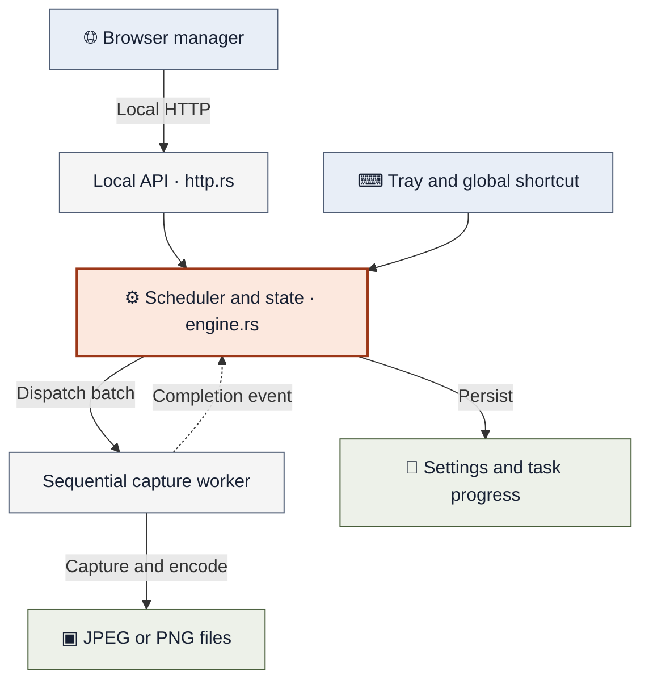
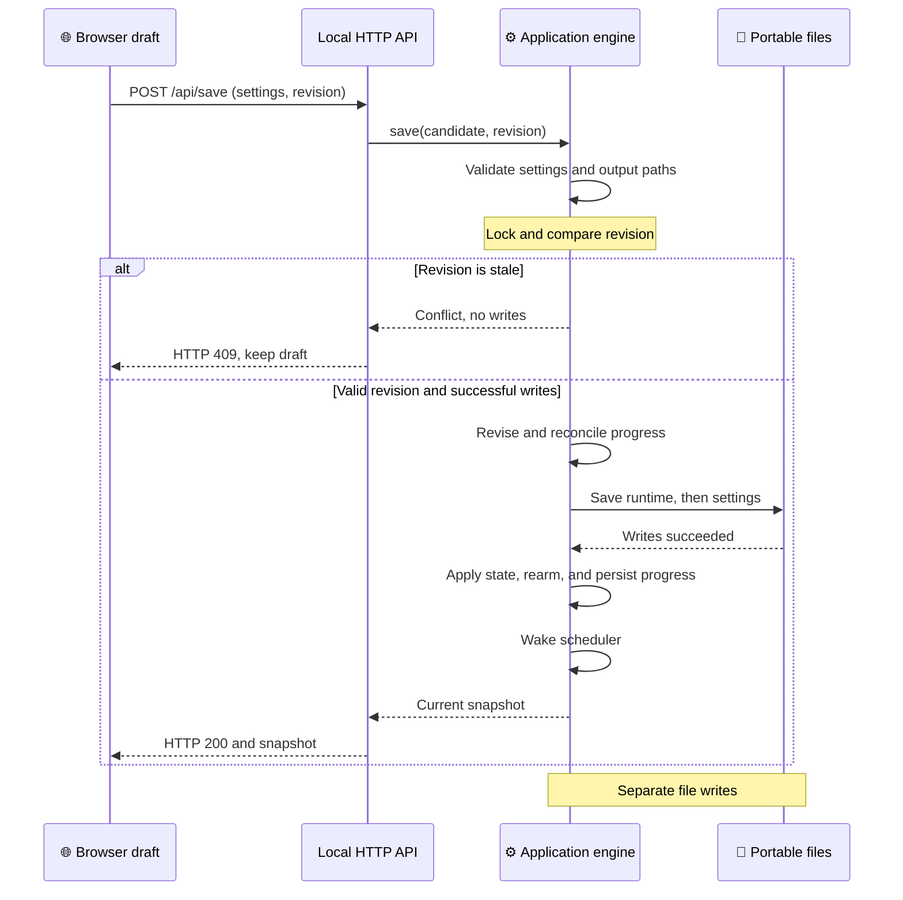

# Architecture and API

[Documentation index](README.md) · [Configuration guide](configuration.md) · [Project structure](project-structure.md)

The portable executable owns scheduling, native capture, and persistence. The browser is a local control surface: closing it leaves the app running, while exiting from the tray stops it.

## Runtime overview

[Mermaid source](diagrams/runtime-overview.mmd)

Follow the control and capture paths:

1. **Control:** browser requests enter through the loopback HTTP API; tray and shortcut actions call the application directly.
2. **Coordinate:** the engine keeps application state, calculates scheduled work, and dispatches captures to one sequential worker.
3. **Capture:** the worker checks desktop availability, captures monitors, and writes the image files.
4. **Persist:** settings and task progress live in `data/`; images go to each task's folder or the standalone capture folder.

Solid arrows show requests, dispatch, and file output. The dashed arrow returns capture results to the engine. Configuration reads, HTTP responses, and session notifications are omitted; the sections below describe their rules.

[Modules](#module-map) · [Scheduling](#scheduler-and-capture-worker) · [Standalone captures](#standalone-captures) · [Windows integration](#windows-integration) · [Local HTTP](#local-http-boundary) · [Persistence](#persistence-and-recovery) · [Saving edits](#saving-edits-with-revision-checks) · [API](#api-reference)

## Module map

| Module | Responsibility |
| --- | --- |
| `src/config.rs` | Strict schema-v2 settings and typed edit validation |
| `src/schedule.rs` | Pure, timezone-parameterized occurrence calculations |
| `src/engine.rs` | Application state, scheduler, worker dispatch, and capture results |
| `src/platform.rs` | Win32 tray, shortcut, session events, folder picker, startup, and GDI capture |
| `src/storage.rs` | Portable paths, migration, atomic file replacement, and four bounded 1 MiB log files |
| `src/output.rs` | Filename tokens, collision-free `CREATE_NEW` reservations, and JPEG/PNG encoding |
| `src/http.rs` | Loopback HTTP server, request validation, and API routing |
| `src/localization.rs`, `ui/i18n.js` | Shared language packs for native controls and browser text |
| `ui/` | Embedded manager UI and compiled stylesheet |

## Scheduler and capture worker

`engine.rs` owns one scheduler thread waiting on its event channel until the next deadline. It arms occurrences once and sends a bounded batch to one sequential capture worker.

- **Cadence:** a busy worker causes new recurring occurrences to be skipped. Interval anchors remain independent of encoding time.
- **One-time attempts:** runtime progress is persisted before dispatch, so interrupted one-time captures cannot retry after restart.
- **Stale work:** completion checks task generations; edits invalidate stale work. Session/display epochs invalidate captures spanning a desktop change.
- **Stop conditions:** a duration/deadline is exclusive; an occurrence at the deadline does not run.

## Standalone captures

| Behavior | Scheduled capture | Standalone capture |
| --- | --- | --- |
| Trigger | Enabled task reaches its next occurrence | Browser, tray, or saved global shortcut |
| Destination and image settings | Saved task configuration | Saved manual folder; JPEG quality 85, no cursor, date subfolders |
| While scheduling is paused | Does not capture | Available if the desktop is capturable and the worker is idle |
| Task progress | Successful batches count toward task limits | Does not change task progress |

Manual captures use the same bounded, sequential capture worker as schedules, with a transient default capture configuration and the persisted `manualOutputFolder` preference (default `captures`). The folder is copied into the request when accepted, so subsequent preference edits do not redirect an in-flight capture.

Browser and tray capture/open actions share this preference and call the same standalone operation. Relative paths resolve from the executable directory; absolute paths are retained.

Manual captures do not look up a saved task and never add an entry to runtime task progress. Pause, task edits and task deletion do not invalidate them; desktop/session changes still do. The latest manual result/files/time are kept in application memory and bounded logs; screenshot files remain after restart.

## Windows integration

`platform.rs` contains the Win32 boundaries: session-wide named mutex shared by all portable copies, tray message loop, session/power/time/display notifications, COM folder picker and Startup shortcut, and GDI capture. GDI, icon, desktop, handle, and COM ownership has deterministic cleanup.

### Desktop availability

Desktop availability requires both an active Windows session and the input desktop named `Default`. Capture checks availability before and after each monitor, and after saving the batch. A batch counts only after every image is saved; failed batches remove their own partial output.

### Global shortcut

Global capture shortcuts use the persisted `captureShortcut` preference (`enabled`, `modifiers`, `key`; default Ctrl+Shift+S). The tray thread registers the selected chord with Windows `RegisterHotKey` and `MOD_NOREPEAT`; `WM_HOTKEY` invokes the same standalone capture worker.

Settings saves post a refresh to the window thread, so reassignment needs no restart. The old registration is released before the new one is applied; failures appear separately as `shortcutError`, and `shortcutActive` is only populated after successful registration. Disable/exit unregister the key. Browser drafts do not affect shortcut capture until saved. Registration semantics follow [Microsoft's RegisterHotKey documentation](https://learn.microsoft.com/en-us/windows/win32/api/winuser/nf-winuser-registerhotkey).

### Startup and test entry points

The normal entry point uses the Windows GUI subsystem. `--background` suppresses browser launch, as used by the optional Startup shortcut. `--print-url` writes the local control URL to redirected stdout for tests; treat that output as a session secret. The test host in `examples/` has no capture access and is not distributed.

## Local HTTP boundary

`http.rs` binds `127.0.0.1:0` directly, avoiding a probe/bind port race. Four fixed request workers and an eight-connection queue bound resource use. Headers are limited to 16 KiB, bodies to 1 MiB, and reads have deadlines.

APIs require an exact Host, matching Origin, and a random per-launch token; cross-site fetches, duplicate headers, chunked transfer and CORS are rejected. The launch URL places the token in the fragment; the UI moves it into tab session storage and removes the fragment from browser history. Tokens and images are never logged.

UI assets and third-party notices are compiled into the EXE. A restrictive content-security policy disallows inline scripts, framing and external assets.

## Persistence and recovery

No external filesystem edits are watched: edit through the manager, or exit before editing JSON and restart. Individual files are atomically replaced with flush/write-through semantics. Configuration and runtime are separate files, not a cross-file database transaction.

| Failure | App response |
| --- | --- |
| Corrupt settings | Recover the last valid copy with scheduling paused |
| Corrupt runtime progress | Stop startup instead of silently resetting capture limits |
| Configuration save failure | Reject the candidate settings, attempt to restore prior runtime progress, and report an error; pause scheduling if progress restoration fails |
| Runtime persistence failure | Pause scheduling |

## Language and embedded UI

Schema 2 also accepts a `language` preference (`en` or `zh-Hant`), defaulting to `en` when absent. It is saved through the existing revision-checked settings API.

`ui/i18n.js` loads the two embedded JSON packs, binds static text/accessible labels without replacing controls, and formats dynamic text and dates. User content and persisted schedule values are never translated. `src/localization.rs` shares the Traditional Chinese pack with native tray labels and the picker title. Unknown diagnostic strings retain the original details under a localized explanation.

The UI uses [Tailwind's build-time CLI](https://tailwindcss.com/docs/installation/tailwind-cli), pinned in the npm lockfile. `ui/tailwind.css` defines theme tokens, accessible component recipes and responsive rules; explicit sources restrict class scanning to the bundled HTML/JS. `npm run build:css` produces the committed `ui/style.css`, which Rust embeds unchanged. `npm run check:css` compiles independently and rejects stale output in CI.

No stylesheet compiler, CDN or browser runtime dependency ships to users. The Tailwind MIT license is included in the embedded third-party notices. The capture settings disclosure remembers its open state within the browser session; unsaved edits and shortcut failures remain indicated when collapsed.

## Saving edits with revision checks

Each manager edit carries the revision it started from. A second window may save first, so the engine compares that revision with its current state before writing. A stale edit returns HTTP 409, and the task editor keeps the draft open.

[Mermaid source](diagrams/settings-save.mmd)

This sequence assumes an authorized request and valid settings. It shows the conflict path and a successful save; validation errors and disk failures return an error before the candidate becomes live. If a file write fails, the engine attempts to restore the previous runtime progress. A failed restoration pauses scheduling and clears pending occurrences.

The engine also persists progress after applying and rearming a successful save. If that later write fails, the returned snapshot reports an error with scheduling paused. A successful HTTP response therefore still needs to be read for application status.

Imports use the same save path after validation forces `paused = true`. The revision belongs to the destination manager; the exported file's revision does not override it. See [configuration import](configuration.md#import-a-configuration-file) for the user workflow.

Source: [settings save](../src/engine.rs), [HTTP routes and status codes](../src/http.rs), and [task editor](../ui/app.js).

## API reference

All APIs use POST with `Content-Type: application/json` and `X-App-Token`:

| Path | Request | Result |
|---|---|---|
| `/api/status`, `/api/config` | `{}` | Settings, per-task progress/next execution, availability, errors, default task, manual capture running/result/output folder |
| `/api/save` | `{settings, revision}` | Updated snapshot; HTTP 409 for stale revision |
| `/api/export` | `{}` | Saved schema-v2 settings only, without runtime state or session credentials |
| `/api/validate-import` | `{settings}` | Validated settings with scheduling paused; no mutation |
| `/api/import` | `{settings, revision}` | Replaces settings through the normal save path with scheduling paused; HTTP 409 for stale destination revision |
| `/api/restart` | `{}` | Requests an application restart on Windows and returns `{accepted: true}`; rejects nonempty options |
| `/api/pause` | `{paused, revision}` | Updated snapshot |
| `/api/capture` | `{}` | Standalone capture using app defaults; accepts no task ID; busy/unavailable requests rejected |
| `/api/open-captures` | `{}` | Opens/creates the saved standalone capture folder |
| `/api/preview` | `{task}` | Expanded full path for display 1 |
| `/api/folder` | `{}` | Selected path, or `null` on cancellation |
| `/api/open-folder` | `{id}` | Opens the saved task's output root in File Explorer, creating it if missing; rejects unknown task IDs |

API errors use `{ "error": "message" }`. Stale revisions return HTTP 409; failed authorization returns HTTP 403; validation and route-operation errors return HTTP 400.
