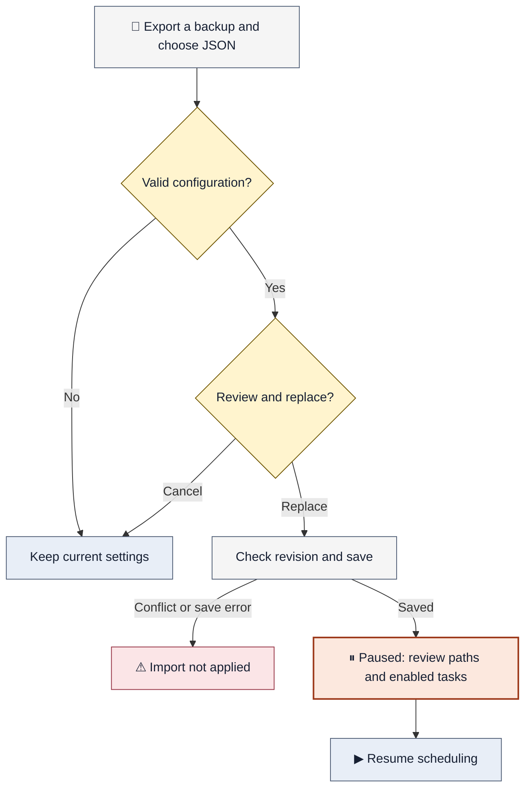

# Apply a configuration

[Documentation index](README.md) · [Quick start](../readme.md#quick-start) · [Architecture and API](architecture.md)

Use the task manager to import a saved JSON configuration or save individual settings. Changes saved through the manager apply immediately and do not require **Restart application**.

[Choose a method](#choose-a-method) · [Import a file](#import-a-configuration-file) · [Save edits](#apply-changes-in-the-manager) · [Edit JSON](#edit-settingsjson-directly) · [Troubleshooting](#if-the-configuration-does-not-apply)

## Choose a method

| You want to… | Use | What to expect |
| --- | --- | --- |
| Change a task or preference | [Manager controls](#apply-changes-in-the-manager) | Applies after saving; no restart |
| Replace tasks and preferences from a backup | [Configuration import](#import-a-configuration-file) | Replaces the current configuration and pauses scheduling |
| Move the app with counts and completed runs intact | [Move the complete state](#settings-and-progress) | Exit first, then move the executable and `data` together |
| Edit JSON by hand | [Direct file editing](#edit-settingsjson-directly) | Exit first; changes load on the next launch |

Use **Export config** for a settings backup. Copy the complete `data` folder while the app is closed when you also need task progress.

## Import a configuration file



[Mermaid source](diagrams/configuration-import.mmd)

**Import replaces all tasks and preferences; it does not merge task lists.** Invalid input, cancellation, and stale revisions do not apply the import. A save error rejects the imported settings; if restoring prior progress also fails, scheduling pauses and the manager reports the error. Resolve that error before resuming.

### Back up and select the file

1. Open `ScheduledScreenshot.exe`, or select **Open task manager** from its tray menu if it is already running.
2. In **Configuration**, select **Export config** to keep a backup of the current saved tasks and preferences.
3. Select **Import config** and choose your configuration `.json` file. Use a file previously created with **Export config**, or an edited copy of that export.

### Confirm, review, and resume

1. Review the filename and task count in **Replace configuration?**. Select **Cancel** to keep the current configuration, or **Replace configuration** to apply the file.
2. After a successful import, review output folders, schedules, the capture shortcut, language, and **Start at sign-in**.
3. Check which tasks are enabled. Import retains each task's enabled/disabled setting, but pauses scheduling globally.
4. Select **Resume scheduling** when ready. Confirm that enabled tasks show the expected next capture time.

### File and path rules

The file must use `schemaVersion: 2`, contain a `tasks` array, and be smaller than approximately 1 MiB. An empty `tasks` array clears the current task list. Invalid JSON or settings are rejected without replacing the current configuration.

Schedules use Windows local time. Relative output paths, such as `captures`, start beside the executable on the destination computer. Absolute paths keep their specified location; review them when transferring settings between computers. In JSON, write Windows paths with escaped backslashes, for example `"C:\\Screenshots"`.

## Apply changes in the manager

All changes in this table apply after a successful save, without restarting. Typing or selecting a draft value alone does not apply it unless the control saves automatically.

| Change | Where to edit | Apply with |
| --- | --- | --- |
| Task schedule, output, image settings, or stop condition | Task → **Edit** | **Save task** |
| Standalone capture destination | **Capture settings** → **Save screenshots to** | **Save folder** |
| Global shortcut and its enabled state | **Capture settings** | **Save shortcut** |
| Language | **Language** | Saves automatically |
| Start at sign-in | **Keep it running** | Saves automatically |
| Pause state | Manager or tray menu | **Pause scheduling** / **Resume scheduling** |

**Capture now** and **Open captures folder** also save a pending standalone folder edit before using that destination. Keyboard and tray captures use the saved destination.

The standalone capture folder is separate from each task's output folder. **Capture now** saves a screenshot to the standalone destination. To verify a scheduled task's settings, check its next capture, last result, and **Open folder** after a scheduled run.

## Edit `settings.json` directly

The active configuration is `data/settings.json` beside the executable:

```text
ScheduledScreenshot.exe
data/
  settings.json
  settings.last-good.json
  runtime-state.json
```

1. Select **Exit** from the tray menu. Closing the browser tab leaves the app running.
2. Back up the complete `data` folder if you want to preserve both settings and task progress.
3. Edit `data/settings.json` and save it as UTF-8 JSON. Keep `schemaVersion` at `2` and retain existing task IDs when editing existing tasks. Set `"paused": true` if you want to review the changes before scheduled captures resume.
4. Launch `ScheduledScreenshot.exe` again. The app reads the file at startup; it does not watch the file for changes while running.
5. Review the loaded settings and any error message, then enable tasks and resume scheduling as needed.

Exit **before** editing the file. Editing it while the app is running and then clicking **Restart application** can lose edits if the running app saves its in-memory settings. Restart is unnecessary for imports and changes saved through the manager.

Change **Start at sign-in** through the manager so the app also updates the Windows startup shortcut; editing the JSON value alone does not create or remove that shortcut.

## Settings and progress

| Item | Included in Export config? | How to preserve it when moving |
| --- | --- | --- |
| Tasks and preferences | Yes | Import the export, or move `data` with the executable |
| Capture counts and completed runs | No | Move the complete `data` folder while the app is closed |
| Logs | No | Move the complete `data` folder while the app is closed |
| Screenshot files | No | Move the relevant output folders separately |

Importing onto another installation does not restore previous capture counts or completed runs. Existing matching tasks retain progress according to the normal edit rules: changing a schedule or stop condition, or re-enabling a task, can reset the corresponding progress.

To move the complete application state, exit the app and move the executable together with its `data` folder. Move screenshot folders separately if you want to keep their images. After moving the executable, turn **Start at sign-in** off and on again to update the startup shortcut.

## If the configuration does not apply

| Symptom | What to do |
| --- | --- |
| Settings changed in another window | Cancel the import, refresh the manager, and select the file again. Copy any task-edit draft before refreshing. |
| Scheduling remains paused | Review imported tasks, enable those you want to run, then select **Resume scheduling**. |
| Shortcut unavailable | Choose another combination and select **Save shortcut**; another app may already use it. |
| Settings rejected at startup | The app attempts recovery from `settings.last-good.json` with scheduling paused. Correct the file while the app is closed, or review and save through the manager. |
| Import fails while saving | Read the error, check that the app folder is writable, and review scheduling status. Failed progress recovery pauses scheduling; use a backup if progress cannot be recovered. |
| Runtime progress is invalid | Close the app and restore `data/runtime-state.json` from a backup. Configuration import does not restore progress. |
| A different portable copy opens | Exit the running copy from its tray menu before launching another copy; only one runs per Windows session. |

See the [README](../readme.md) for task creation, scheduling behavior, and portable setup.
