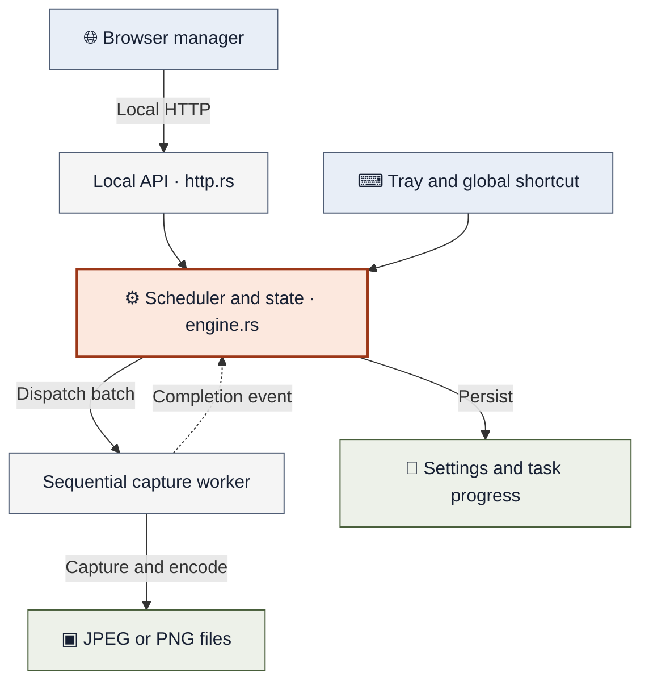

# Scheduled Screenshot

A portable screenshot scheduler for **Windows 10/11 x64**. Capture every monitor on a schedule or with a global shortcut, and manage tasks in your default browser.

- Schedule captures once, at an interval, or at specific times on selected weekdays.
- Save JPEG or PNG images with optional cursor capture, date folders, and filename templates.
- Stop after a deadline, elapsed duration, or number of successful captures.
- Run from a single executable with English and Traditional Chinese interfaces.

No installer, administrator privileges, .NET, Node.js, Rust, or WebView is required to run the packaged app. The UI and other assets are embedded; no asset downloads are needed.

[Quick start](#quick-start) · [How it works](#how-it-works) · [Create a task](#create-a-task) · [Capture now](#capture-now-and-keyboard-shortcut) · [Configuration](#export-and-import-configuration) · [Troubleshooting](#troubleshooting) · [Build and verify](#build-and-verify) · [Documentation](#documentation)

## Quick start

1. Put `ScheduledScreenshot.exe` in a writable folder, such as `C:\Users\you\Apps\ScheduledScreenshot`. If you have `ScheduledScreenshot-win-x64.zip`, extract it first. If you only have the source, follow [Build and verify](#build-and-verify) to create the executable.
2. Double-click the executable. The task manager opens in your default browser and the app adds a tray icon.
3. Select **Capture now** to take a first screenshot. Select **Open captures folder** to view it. By default, images are saved beside the executable under `captures/YYYY-MM-DD/`, one JPEG containing all monitors in their desktop arrangement.
4. To automate captures, select **New task**, name it, and set **Repeat at an interval** to **5 Minutes**. Choose **Every day**, review **Files & image**, check **Enable task**, and select **Save task**.
5. Check the task's **Next capture** time. If scheduling is paused, select **Resume scheduling**. After a run, check **Last result** and the task's **Open folder** button.

**Closing the browser tab keeps the scheduler running.** Use the tray icon to reopen the manager or select **Exit** to stop the app. Scheduled captures require an awake, unlocked Windows session.

## How it works

The browser manages tasks and preferences through a local HTTP API. Tray actions and the global shortcut reach the same application engine directly. One worker handles both scheduled and standalone captures.



Settings and scheduled-task progress are saved in `data/` beside the executable. Images go to the task's output folder or the standalone capture folder. Manual captures do not change task progress.

See [Architecture and API](docs/architecture.md) for timing, desktop availability, persistence, and revision checks. The editable [Mermaid source](docs/diagrams/runtime-overview.mmd) matches this diagram.

## Create a task

Select **New task**, enter a name, and work through the editor tabs:

| Tab | What to configure |
| --- | --- |
| **Schedule** | Run once at a date/time, repeat in seconds/minutes/hours, or capture at specific times on selected weekdays. Intervals can be limited to active hours within the same day. |
| **Files & image** | Choose an output folder, filename template, JPEG or PNG, JPEG quality, whether to split images by screen, and whether to include the cursor. Date subfolders are enabled by default. |
| **Stop conditions** | Optionally stop at a deadline, after an elapsed duration, or after a number of successful captures. |

Review **Your capture plan**, check **Enable task** when ready, and select **Save task**. **New and duplicated tasks start disabled.** The preview shows the complete output path for the combined image, or monitor 1 when splitting images by screen.

Click a task name or **Edit** to change it. Tasks can also be duplicated, deleted, or enabled/disabled. The editor keeps Save visible, highlights invalid fields, and asks before discarding unsaved changes.

### Output folders and filenames

Relative paths start beside the executable; absolute paths keep their specified destination. Each capture saves one image containing all monitors in their desktop arrangement by default. Enable **Split images by screen** to save a separate image for each monitor. Empty areas between monitors are black. A capture counts as successful only when all output images are saved. Existing files receive numbered suffixes and are never overwritten.

Use **Open folder** on a task to open its output root, including any date subfolders. The folder is created if it does not exist yet.

The default filename template is `{timestamp}_{display}`. Supported tokens are:

```text
{timestamp}  {date}  {time}  {task}
{taskId}  {taskId8}  {display}  {displayIndex}
```

For combined images, `{display}` is `all-monitors` and `{displayIndex}` is `1`. When splitting, they identify each monitor. Tokens are case-insensitive. Insert them using the editor's token buttons; the image extension is added automatically.

## Capture now and keyboard shortcut

Use **Capture now** in the manager or tray menu, or press **Ctrl+Shift+S** while the app is running. This works with no tasks, with the browser closed, and while scheduling is paused.

Standalone captures combine all monitors in one image by default and use JPEG quality 85, no cursor, date subfolders, and `{timestamp}_{display}` filenames. They use their own destination and do not change scheduled task progress or use a task's image settings.

Expand **Capture settings** to customize:

| Setting | How to apply it |
| --- | --- |
| Screenshot destination | Enter **Save screenshots to** or use **Browse...**, then select **Save capture settings**. |
| Split images by screen | Enable to save one image per monitor, then select **Save capture settings**. |
| Global shortcut | Choose modifiers and a letter, digit, or F1–F11, then select **Save shortcut**. |
| Disable the shortcut | Uncheck **Enable capture shortcut**, then select **Save shortcut**. |

**Capture now** and **Open captures folder** also save pending destination and screen mode edits before using them. Keyboard and tray captures use the saved capture settings. Shortcut conflicts appear in the manager; choose another combination if needed. Holding the shortcut does not repeat captures.

## Keep it running

- **Start at sign-in:** enable this under **Keep it running** to launch the app when you sign in. It defaults off.
- **Pause/resume:** use the manager or tray menu to control scheduled captures. Manual captures remain available while paused.
- **Restart application:** use the manager or tray menu to restart and reopen the manager. Saved settings, pause state, and task progress are preserved. Save or discard browser edits first.
- **Exit:** use the tray menu to stop the app. The tray also provides access to the manager, captures folder, and logs.

Only one instance runs per Windows session. Launching another portable copy reopens the running copy's manager. Exit the running app before switching copies or replacing its executable.

### Scheduling behavior

Schedules use Windows local time. The app runs in your signed-in session; it does not install a service or wake the computer.

- Locked, secure, or disconnected desktops cannot be captured. Concurrent captures are rejected.
- Recurring runs missed during sleep, shutdown, pause, or another capture are skipped. Intervals keep their cadence independently of encoding time.
- Dated one-time tasks finish as completed, failed, or missed, without retries. Change the date before re-enabling an old one-time task.
- Re-enabling a task resets its run progress. Schedule changes reset the schedule anchor and one-time slots; stop-condition changes reset count/duration progress.
- Deadlines exclude runs at or after the deadline. Duration starts when enabling the task or changing its duration setting, and includes paused time.

Clock or timezone changes trigger recalculation. Nonexistent one-time local times are rejected; recurring times in a daylight-saving gap are skipped. Repeated clock times use the later occurrence only. Imported legacy `fixedOnce` schedules attempt each time slot once in total on an eligible weekday, preserving completed slots across restarts.

## Language / 語言

Choose **English** or **繁體中文 (zh-Hant)** from **Language** at the top of the manager. The preference is saved with the portable app and applies to the manager, editor, help, common messages, tray menu, and folder-picker title.

在工作管理介面上方的 **Language / 語言** 選單選擇 **繁體中文**。語言偏好會隨程式設定儲存，重新啟動後仍會保留。

Task names, paths, tokens, and schedule values stay as entered. Windows-owned dialog controls follow the Windows display language; low-level diagnostics and logs retain their original text.

## Export and import configuration

Use the manager's **Configuration** section to back up or transfer saved tasks and preferences:

1. Select **Export config** to download a JSON backup before replacing settings.
2. Select **Import config** and choose an exported file (schema version 2, up to 1 MiB).
3. Review the filename and task count, then select **Replace configuration**.
4. Review output paths and enabled tasks, then select **Resume scheduling**.

**Import replaces all current tasks and preferences and pauses scheduling.** Canceling or importing invalid settings leaves the current configuration unchanged. Imports and manager changes apply immediately after saving, without restarting.

Exports exclude screenshots, logs, and run progress. New tasks start with fresh progress; existing matching tasks follow the normal edit rules. To preserve counts and completed runs when moving the app, move the complete `data` folder instead.

See [Apply a configuration](docs/configuration.md) for detailed import steps, direct JSON editing, and troubleshooting.

## Portable files

```text
ScheduledScreenshot.exe
data/
  settings.json             # Tasks and preferences
  settings.last-good.json   # Recovery copy of valid settings
  runtime-state.json        # Task progress
  logs/                     # Four files, approximately 1 MiB each
captures/                   # Default screenshot destination
```

**Move or upgrade:** exit the app first. Keep the executable and `data` together to preserve settings and progress; move `captures` too if you want its existing images. Relative output paths follow the executable, while absolute paths retain their destination. Unwritable application folders produce an instruction to move the app; data is not redirected elsewhere.

**Start at sign-in:** this creates `ScheduledScreenshot.lnk` in your account's Startup folder. Turn the setting off and on after moving the executable to update the shortcut. Disable it before deleting the app. There are no automatic updates.

**Remove:** exit the app and delete its folder. Images saved elsewhere remain.

**Edit or recover settings:** use the manager for live edits. Exit before editing `data/settings.json` directly. Invalid settings recover the last valid copy with scheduling paused; corrupt runtime progress requires restoring its file rather than silently resetting limits. Stale browser edits report a conflict and keep the draft open.

Legacy settings/runtime beside the executable are backed up to `data/legacy-backup` and migrated to schema 2. IDs and progress are preserved, and legacy output paths become absolute to retain their destinations. Original files remain.

## Troubleshooting

| Symptom | First check |
| --- | --- |
| A task does not capture | Enable the task, resume scheduling, and check **Next capture** and **Last result**. The desktop must be awake and unlocked. |
| Screenshots appear in a different folder | **Capture now** uses the standalone destination; scheduled runs use the task's output folder. Relative paths start beside the executable. |
| A shortcut is unavailable | Choose another combination under **Capture settings**, then select **Save shortcut**. Another app may already use the current one. |
| An import leaves scheduling paused | Review paths and enabled tasks, then select **Resume scheduling**. Imports deliberately pause scheduling. |
| Saving reports a conflict | Another window saved first. Keep a copy of your draft, reload the manager, and apply the edit again. |
| A different portable copy opens | Exit the running app from its tray menu before launching another copy. Only one instance runs per Windows session. |

For recovery and direct JSON edits, see [configuration troubleshooting](docs/configuration.md#if-the-configuration-does-not-apply). Use the tray menu to open logs when a capture or save reports an error.

## Build and verify

Run the following commands from the repository root. The release build uses Docker Linux containers; running the app and native checks requires Windows.

[Docker release](#build-the-release-with-docker) · [Native build](#optional-native-build) · [CI artifacts](#ci-release-artifacts) · [Rust checks](#rust-checks) · [UI and browser tests](#ui-development-and-browser-tests) · [Native smoke and soak](#native-smoke-and-soak-tests)

### Build the release with Docker

Start Docker with Linux containers (Docker Desktop on Windows). Check that `docker info --format '{{.OSType}}'` prints `linux`, then build from PowerShell:

```powershell
./scripts/package.ps1
```

Or use Docker directly from Windows, Linux, or macOS:

```sh
docker build --platform linux/amd64 --target release --output type=local,dest=artifacts/release .
```

The first build downloads the container toolchain, Rust dependencies, and Microsoft CRT/Windows SDK; SDK extraction can take 15 minutes or more with little console output. The prepared SDK is stored in a Docker layer before application sources are copied, so source changes reuse it. Local builds also reuse Cargo registry and compilation caches. No host Rust, Visual Studio, Python, or Node.js installation is needed for release packaging.

The [Dockerfile](Dockerfile) pins Rust 1.90.0, cargo-xwin 0.23.1, Windows SDK 10.0.26100 and CRT 14.44.17.14, builds the locked dependencies for `x86_64-pc-windows-msvc`, and embeds the checked-in UI assets. SDK preparation checks the selected versions even when a local SDK cache already exists. Packaging checks the executable's architecture, embedded manifest and static CRT imports before exporting it. [cargo-xwin](https://github.com/rust-cross/cargo-xwin) downloads the Microsoft build components under their upstream license terms.

Packaging produces these files in `artifacts/release/`:

| File | Contents |
| --- | --- |
| `ScheduledScreenshot.exe` | Standalone app with embedded assets and statically linked MSVC runtime |
| `ScheduledScreenshot-win-x64.zip` | ZIP containing only the executable |
| `SHA256SUMS.txt` | SHA-256 checksums for the executable and ZIP |

On Windows, start the packaged app with `./artifacts/release/ScheduledScreenshot.exe`. Docker is only needed to build it; the exported app runs directly on Windows.

The executable is currently unsigned. Compare `Get-FileHash artifacts/release/ScheduledScreenshot.exe -Algorithm SHA256` with `SHA256SUMS.txt` to verify the packaged executable.

To choose another output folder, including when an earlier release is running:

```powershell
./scripts/package.ps1 -OutputDirectory artifacts/release-docker
```

Exit the running app before replacing its executable. Docker exports go directly to the selected folder; they do not populate the host's `target/` directory.

The Docker release verified on 2026-10-18 was exported to `artifacts/release-docker/`. Checksums, ZIP contents, static CRT imports, embedded manifest settings and Windows loader acceptance passed. Desktop smoke tests were not rerun for that build. See [verification results](docs/verification.md#docker-cache-fixes-2026-10-18-0523-0800) for details and remaining release qualification.

### Optional native build

Install Rust stable (minimum declared version: 1.88), the `x86_64-pc-windows-msvc` target, and Visual Studio C++ build tools with the Windows SDK. From developer PowerShell:

```powershell
rustup target add x86_64-pc-windows-msvc
./scripts/package.ps1 -Native
```

Use `./scripts/package.ps1 -NoBuild` to package an existing executable from `target/x86_64-pc-windows-msvc/release/` without compiling. This option packages a native build; it does not reuse a previous Docker export. Both options support `-OutputDirectory`.

### CI release artifacts

The [Portable Windows build workflow](.github/workflows/windows-build.yml) runs Rust, stylesheet, JavaScript and browser checks on Windows, then builds and validates the release in Docker on Linux. After a successful workflow run, download the `ScheduledScreenshot-win-x64` artifact from GitHub Actions for the executable, portable ZIP and checksums.

CI saves Docker layers with `type=gha,mode=max`, including the prepared SDK. Because [Docker's GitHub cache does not preserve cache mounts](https://docs.docker.com/build/ci/github-actions/cache/#cache-mounts), the workflow separately restores and saves Cargo's registry and target directories with `actions/cache` and a commit-pinned `buildkit-cache-dance` action. Its cache key includes the Dockerfile, Cargo configuration, manifest and lockfile; changes to those inputs create a new Cargo cache.

When build inputs change, Docker clears only this application's Cargo outputs before rebuilding. Compiled dependencies stay cached, while restored timestamps cannot cause an older executable to be packaged.

### Rust checks

These checks use the native Windows Rust/MSVC toolchain described above.

```powershell
cargo fmt --all -- --check
cargo clippy --locked --all-targets -- -D warnings
cargo test --locked --all-targets
```

### UI development and browser tests

Use Node.js 24 with the pinned dependencies in `package-lock.json`:

```powershell
npm ci
npm run build:css
npm run check:css

# Optional: rebuild styles while editing
npm run watch:css
```

Edit `ui/tailwind.css` and the classes in `ui/index.html` / `ui/app.js`, then include the generated `ui/style.css` in your changes. Cargo uses the checked-in stylesheet, so building the app without UI changes does not require Node.js. CI checks that the stylesheet is current.

Language packs live in `ui/locales/en.json` and `ui/locales/zh-Hant.json`. Keep their English source keys and named placeholders in sync. Translations are rendered as text, and native menus share the same packs. Rebuild the executable after changing embedded UI assets or translations.

Run the isolated browser suite without desktop capture:

```powershell
npx playwright install chromium
cargo build --locked --example ui-test-host
npm run test:browser
```

### Native smoke and soak tests

Native tests require Python, an unlocked Windows desktop, and the normal app closed because all portable copies share the session-wide instance guard.

```powershell
python tests/native/smoke.py --exe artifacts/release/ScheduledScreenshot.exe

# Include browser checks after installing the UI tools and Chromium above
python tests/native/smoke.py --browser --exe artifacts/release/ScheduledScreenshot.exe

# Short diagnostic; omit --minutes and --interval for the default 24-hour soak
python tests/native/soak.py --exe artifacts/release/ScheduledScreenshot.exe --minutes 2 --interval 5
```

Smoke testing uses an isolated folder, captures screenshots, briefly creates/removes a Startup shortcut while preserving any previous one, cancels a native picker, and simulates session events on its own window. `PLAYWRIGHT_MODULE` and `CHROME_PATH` can select an existing browser test installation.

The soak test records memory, handles, CPU, and progress in `artifacts/soak-*`, deletes its generated captures, and exits its instance when complete. Idle targets with the browser closed are at most 40 MiB private working set and CPU below 0.05% of one logical core. See [verification status](docs/verification.md) for completed checks and outstanding release qualification.

## Documentation

Use the [documentation index](docs/README.md) to choose a guide by task.

| Guide | Read it to… |
| --- | --- |
| [Apply a configuration](docs/configuration.md) | Import a backup, save settings, edit JSON, or recover from an error |
| [Project structure](docs/project-structure.md) | Find source modules, build scripts, test commands, and diagram maintenance instructions |
| [Architecture and API](docs/architecture.md) | Understand the runtime, capture worker, persistence, and local API |
| [Verification](docs/verification.md) | Review dated test evidence and outstanding release qualification |
| [Legacy audit](docs/legacy-audit.md) | Review migration behavior and preserved legacy files |
| [Implementation handoff](docs/plans/2026-10-18-0201-portable-windows-scheduler.md) | Trace implementation history and progress |

**Visual walkthroughs:** [Runtime overview](docs/architecture.md#runtime-overview) · [Configuration import](docs/configuration.md#import-a-configuration-file) · [Settings save and conflicts](docs/architecture.md#saving-edits-with-revision-checks).

Diagrams are embedded as Mermaid code in Markdown, with matching `.mmd` sources under `docs/diagrams/`. Use a Mermaid-capable Markdown viewer to render them; the surrounding text explains each flow too.

Dependency notices are embedded and accessible in the manager. After dependency updates, refresh them with `python scripts/notices.py`.
